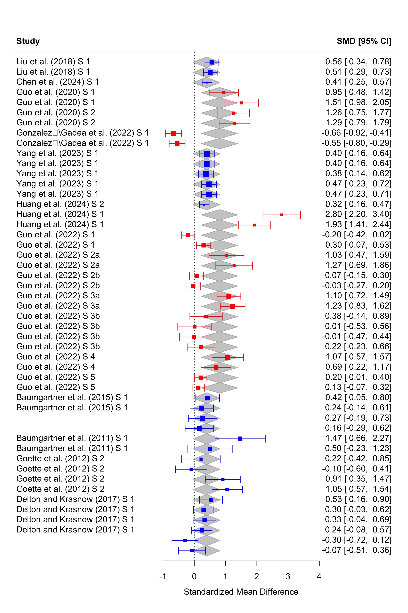

# Main Effect

Download Coding Sample - Coding Merged.csv and save it to the same directory as this README file. Notice: current Coding Sample - Coding Merged need to manually add information for some columns.

## H1: The Effects of Aggressor’s Identity on Punishment in unfair condition

H1a (In-group Favouritism): Third parties will punish out-group aggressors more harshly than in-group aggressors, controlling for victim status.

H1b (Black Sheep Effect): Third parties will punish in-group aggressors more harshly than out-group aggressors, controlling for victim status.

Our data supports H1a In-group Favouritism instead H1b Black Sheep Effect. That is a medium to large positive effect of out-group aggressor on punishment.

## H2: The Effects of Victim’s Identity on Punishment in unfair condition

Third parties will punish more strongly when the victim is an in-group member than when the victim is an out-group member.

Our data supports H2. That is a small to medium positive effect of in-group victim on punishment.

## H3: The Interaction Effect of Aggressor’s Identity and Victim’s Identity on Punishment in unfair condition

We did not find a significant interaction effect of aggressor’s identity and victim’s identity on punishment in unfair condition.

Multiple methods were used to test the interaction effect, including the Mantel-Haenszel method, meta-regression, and moderator analysis. The results consistently showed no significant interaction effect. We are showing results from moderator analysis here.

Red represents the effect of out-group aggressor on punishment when the victim is an in-group member, and blue represents the effect of out-group aggressor on punishment when the victim is an out-group member. Gray represents the effect of out-group aggressor on punishment when the victim is a neutral member.

## H5: The Effects of Aggressor’s Identity on Punishment in fair condition

## H6: The Effects of Victim’s Identity on Punishment in fair condition

# Moderators

We analysed how participants’ nationality, the cost of punishment, the experimental platform, group manipulation, and game type moderated the effects of interest.

## Group Manipulation

We found that participants tended to punish outgroup aggressors more in the experimental group (red) than in the natural group (blue), in both the unfair condition (Fig. 6) and the fair condition (Fig. 7).

## Experimental Platform

We found that in the unfair condition, participants tended to punish outgroup aggressors more in the in-lab study (red) than in the online study (blue). However, this moderator was not significant in the fair condition.

## Nationality

We found that in the fair condition, participants’ nationality was a significant moderator. Participants in Turkey (green) tended not to punish outgroup targets. Participants in the US (blue) showed a slight tendency to punish outgroup targets. Participants in Switzerland (purple) punished outgroup targets more than those in the US. Participants in China (red) punished outgroup targets most strongly.

However, this moderator was not significant in the unfair condition.

