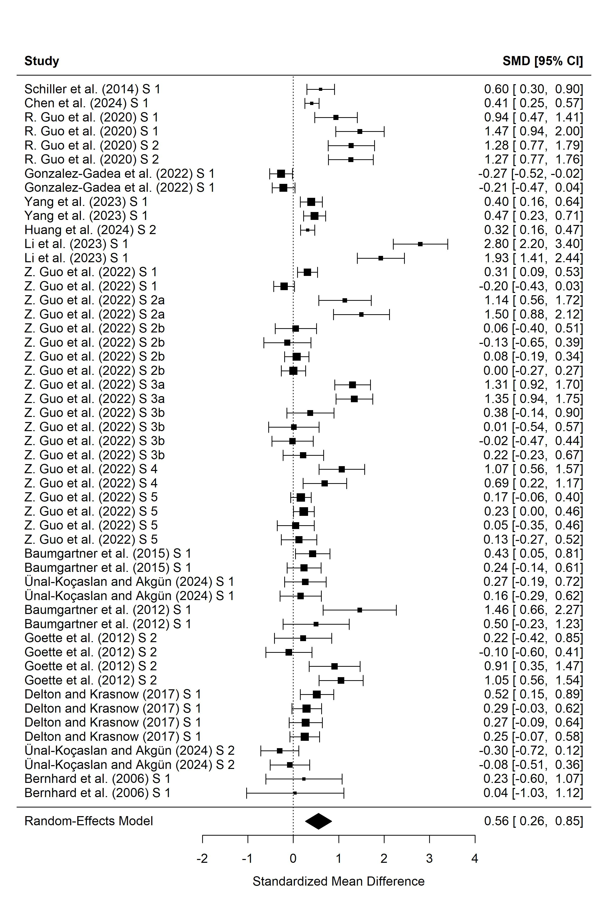
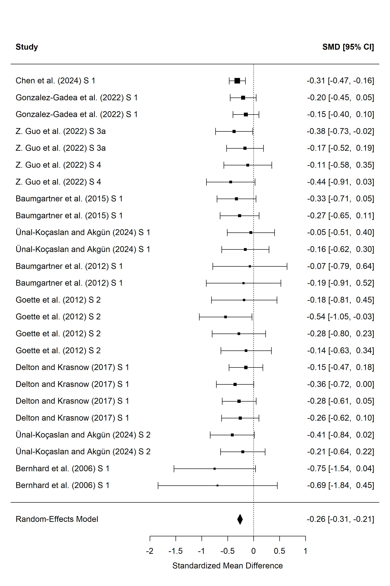
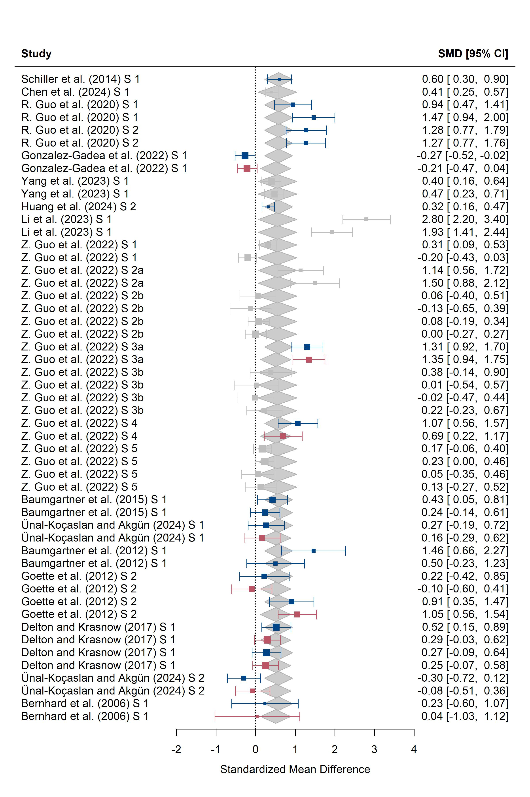
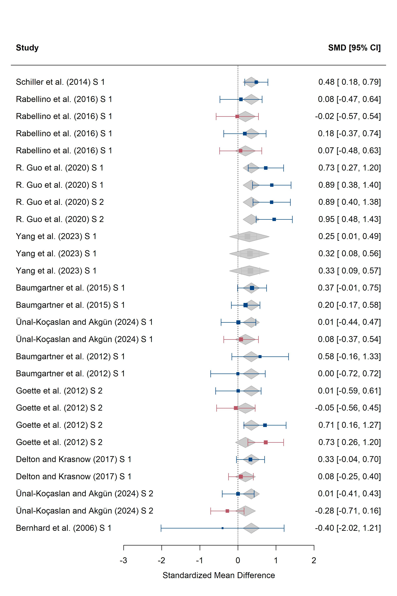
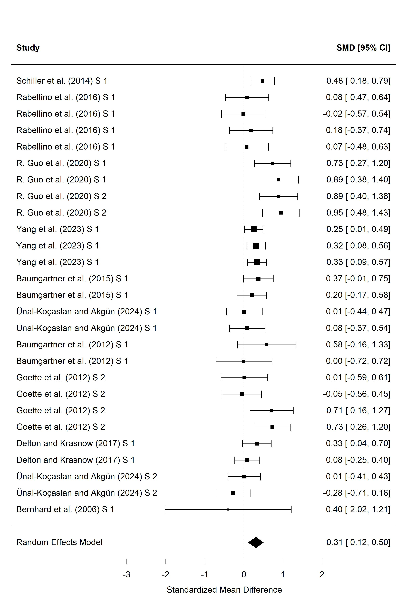
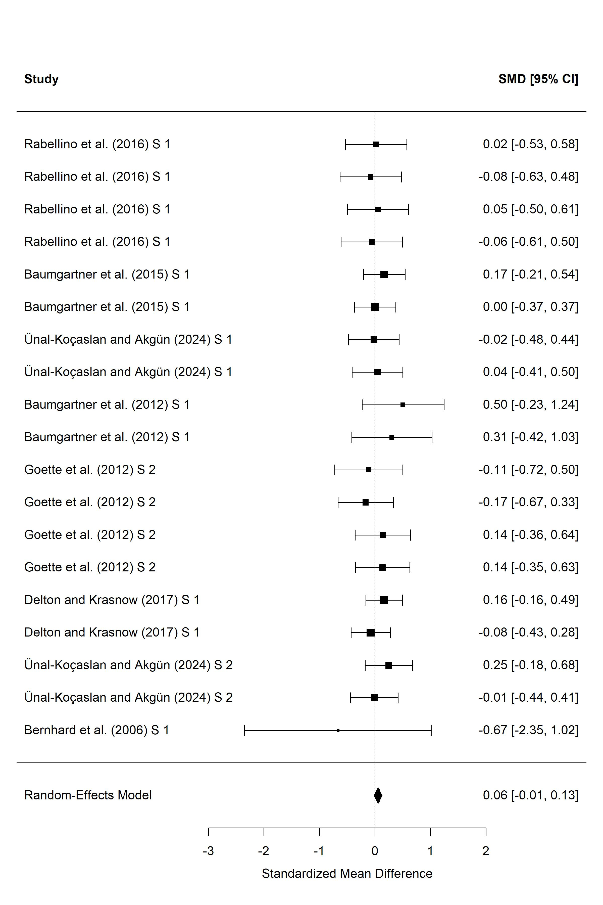
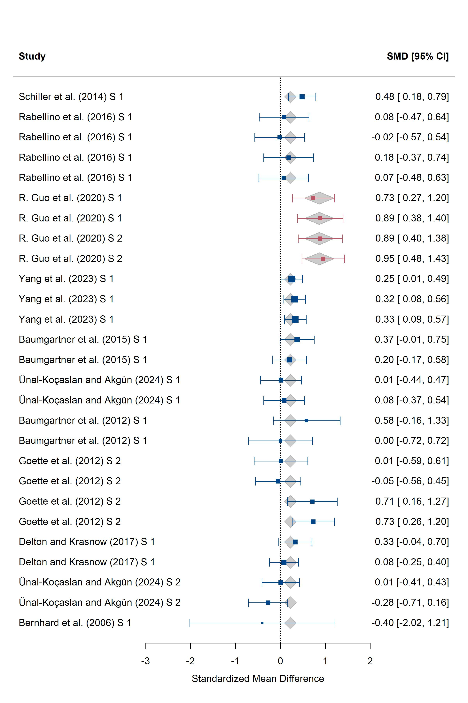
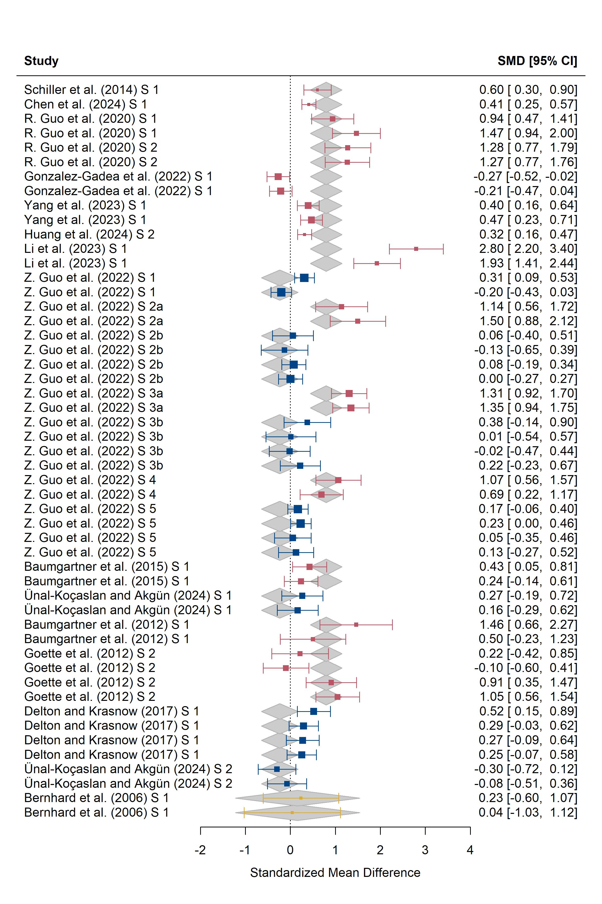
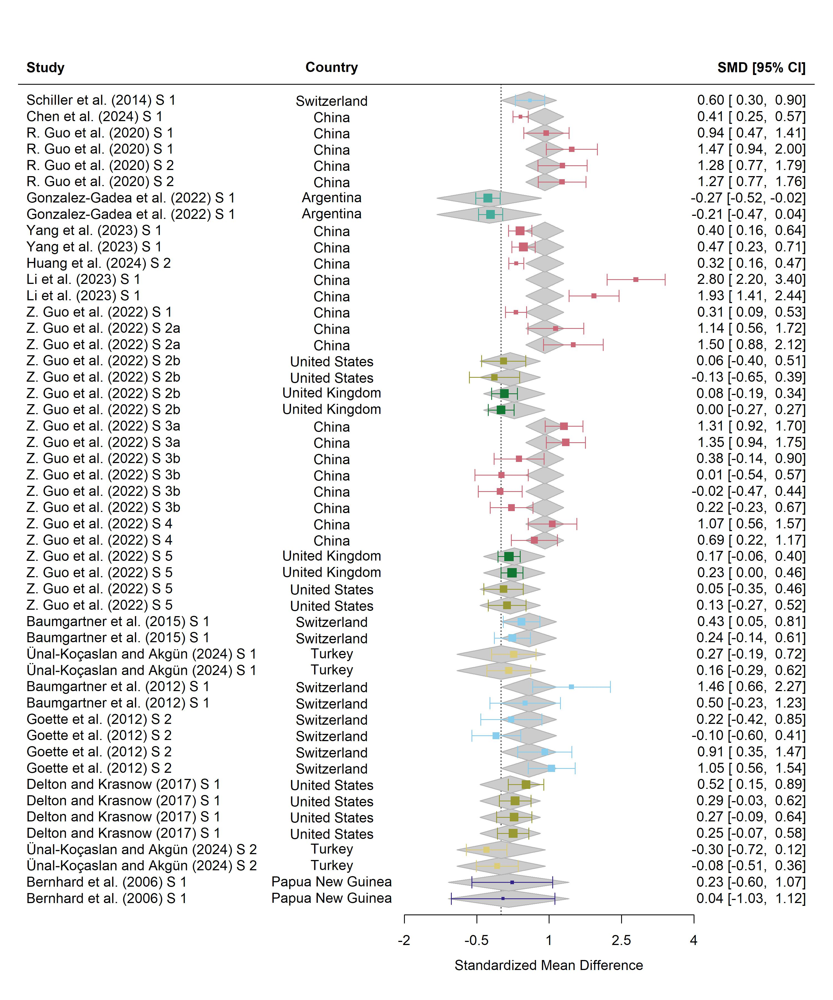
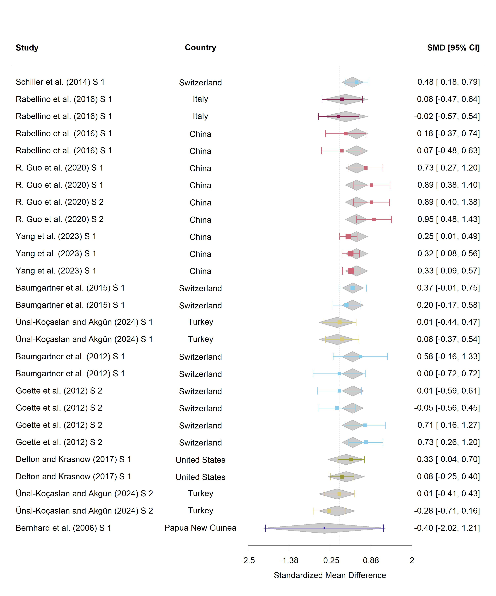

Data and Code for:

Sun, R., Meng, L., McCart, J., Saboor, D., Kenny, A., & Imada, H. (2026). *Altruistic and Antisocial Third-party Punishment in Intergroup Interactions: A Systematic Review and Meta-Analysis*.

<https://pure.royalholloway.ac.uk/en/publications/altruistic-and-antisocial-third-party-punishment-in-intergroup-in/>

------------------------------------------------------------------------

# Main Effect

The main analysis uses `Coding Sample - Final Meta Data.csv` in this directory.

## H1: The Effects of Aggressor’s Identity on Punishment in unfair condition

H1a (In-group Favouritism): Third parties will punish out-group aggressors more harshly than in-group aggressors, controlling for victim status.

H1b (Black Sheep Effect): Third parties will punish in-group aggressors more harshly than out-group aggressors, controlling for victim status.

Our data supports H1a In-group Favouritism instead H1b Black Sheep Effect. That is a medium to large positive effect of out-group aggressor on punishment.

## H2: The Effects of Victim’s Identity on Punishment in unfair condition

Third parties will punish more strongly when the victim is an in-group member than when the victim is an out-group member.

Our data supports H2. That is a small to medium positive effect of in-group victim on punishment.

## H3: The Interaction Effect of Aggressor’s Identity and Victim’s Identity on Punishment in unfair condition

We did not find a significant interaction effect of aggressor’s identity and victim’s identity on punishment in unfair condition.

Multiple methods were used to test the interaction effect, including meta-regression, and moderator analysis. The results consistently showed no significant interaction effect. We are showing results from moderator analysis here.

Red represents the effect of out-group aggressor on punishment when the victim is an in-group member, and blue represents the effect of out-group aggressor on punishment when the victim is an out-group member. Gray represents the effect of out-group aggressor on punishment when the victim is a neutral member.

## H4: The Interaction Effect of Focal player’s Identity and Partner Player’s Identity on Punishment in fair condition

We did not find a significant interaction effect of focal player’s identity and partner player’s identity on punishment in fair condition.

The colour is consistent with the previous figure.

## H5: The Effects of Focal Player’s Identity on Punishment in fair condition

## H6: The Effects of Partner Player’s Identity on Punishment in fair condition

# Moderators

We analysed how participants’ nationality, the cost of punishment, the experimental platform, group manipulation, and game type moderated the effects of interest.

## Group Manipulation

The focal player group membership effect on antisocial TPP was larger in experimental groups (red) than in natural groups (blue; Fig. 7).

## Experimental Platform

The focal player group membership effect on altruistic TPP was larger in lab studies (red) than in online studies (blue). The lab versus online contrast did not reach statistical significance in the CR2 test, *F*(1, 1.13) = 52.879, *p* = .070.

However, this moderator was not significant in the fair condition.

## Nationality

Participants’ nationality significantly moderated the focal player group membership effect on altruistic TPP (Fig. 9) and antisocial TPP (Fig. 10). Both omnibus tests yielded *p* < .001.

